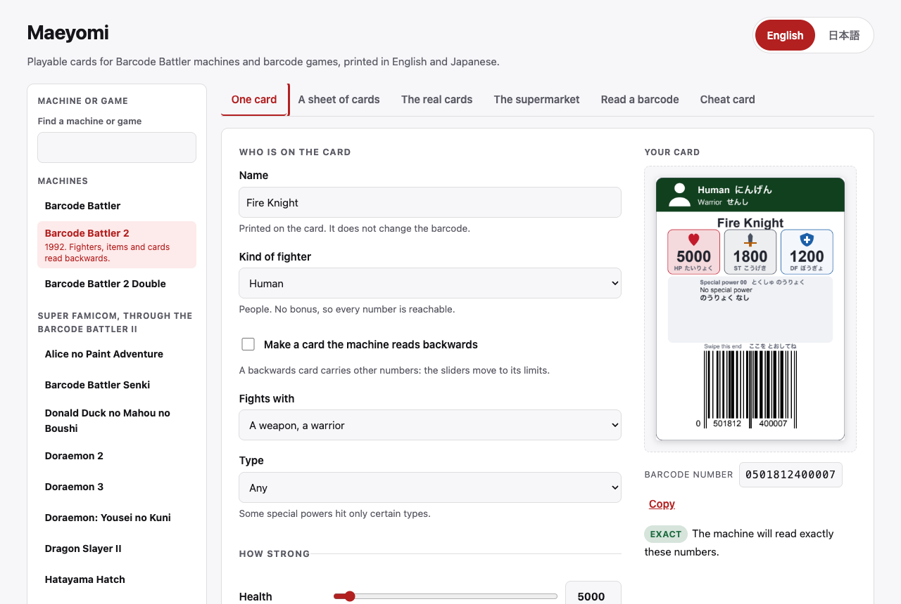
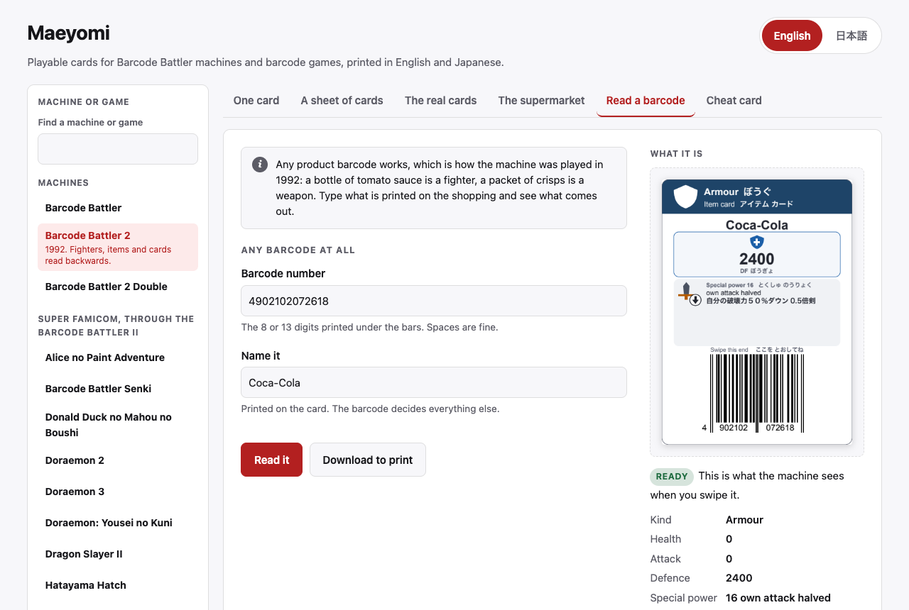
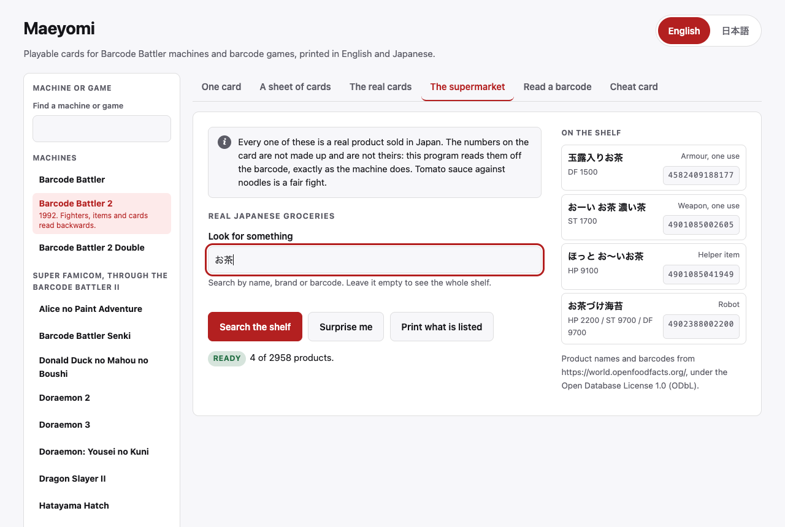

<div align="center">

# maeyomi

<strong>為條碼戰士系列主機和用條碼遊玩的遊戲列印可用的卡片。</strong>

[English](README.md) | [日本語](README.ja.md) | [简体中文](README.zh-Hans.md) | 繁體中文 (香港)

[](https://github.com/gufranco/maeyomi/actions/workflows/ci.yml)
[](https://github.com/gufranco/maeyomi/releases/latest)
[](https://github.com/gufranco/maeyomi/actions/workflows/ci.yml)
[](LICENSE)

<p align="center">
  <a href="#支援的主機和遊戲">支援的主機和遊戲</a> |
  <a href="#安裝">安裝</a> |
  <a href="#打開它">打開它</a> |
  <a href="#在命令列中">命令列</a> |
  <a href="#主機和遊戲">主機和遊戲</a> |
  <a href="#實體卡片">實體卡片</a> |
  <a href="#出處">出處</a>
</p>

</div>

已採錄官方卡片 **3046** 張。日本食品 **2958** 件。特殊能力 **100** 種。每張卡片都以英語和日語兩種語言列印。測試覆蓋率 **100%**。條碼戰士 II 的卡片已在實機上驗證。

---

條碼戰士系列主機，以及一批 Famicom、Super Famicom 和 Game Boy 遊戲，單憑條碼的數字就推導出一名戰士、一件道具或一種效果。本程式把這套運算反向求解：要一張防禦 2400 的護甲卡，它就算出主機會那樣讀取的條碼，再列印出來。maeyomi 是條碼戰士對正面讀取的稱呼，也就是讀出一名戰士的那種讀法。

它涵蓋四台獨立主機，即三台條碼戰士和世嘉玩具的「電視與茶札 茶犬『呼』與生活」，以及 32 款遊戲：六款讀取部在卡匣裡的 Famicom 用 Datach 遊戲；十三款從插在主機上的條碼戰士 II 取得代碼的 Famicom 和 Super Famicom 遊戲；五款透過南夢宮的 Barcode Boy 讀取的 Game Boy 遊戲；帶有自己讀取器的 Game Boy 遊戲「條碼對戰 Bardigun」；三款透過世嘉 HCV-1000 讀取 Code 39 卡片的任天堂 DS 遊戲，即「玩卡片吧! 第一次的 DS」、「時尚魔女 Love and Berry DS 收藏集」和「甲蟲王者 Mushiking 超級收藏集」；以及透過插在麥克風插口的掃描器讀取 Code 128 卡片的兩款任天堂 DS 遊戲「Wantame 音樂頻道 隨處風格」和「流星洛克人 Dragon」；還有卡片帶一條條紋軌道的世嘉玩具 Advanced Pico Beena 遊戲「電車大集合! 玩卡片吧」和「前進吧! 麵包超人 用卡片快樂學 ABC」。對其中每一個，它都能列印出條碼已知的發售卡片、一張按要求訂製的卡片，以及一張作弊卡：該裝置會讀取的最強或最有用的卡片。

每款遊戲的規則都是從遊戲本身的程式裡讀出，並對照在 MAME 中執行的遊戲核對。產生的每個條碼在送上紙張之前都會再經過一次解碼器，列印出的每一頁都會光柵化後用條碼閱讀器讀回。列印出的卡片已在實機條碼戰士 II 上刷過確認。

## 支援的主機和遊戲

下面的每台主機和每款遊戲，都是命令列上的一個 `--device`，也是網頁上 **主機或遊戲** 下的一個項目。主機、遊戲及其卡包的相片見 [barcodebattler.co.uk](https://www.barcodebattler.co.uk/scans/Japan/)。

| 主機或遊戲 | 日文名稱 | 執行於 | `--device` |
|---|---|---|---|
| Barcode Battler | バーコードバトラー | 獨立主機 | `bb1` |
| Barcode Battler 2 | バーコードバトラー2 | 獨立主機 | `bb2` |
| Barcode Battler 2 Double | バーコードバトラー2 ダブル | 獨立主機 | `double` |
| TV Ocha-Ken | テレビとお茶札 お茶犬「ほっ」と生活 | 獨立主機，透過其讀卡器讀取 | `ochaken` |
| Alice no Paint Adventure | アリスのペイントアドベンチャー | Super Famicom，透過條碼戰士 II 讀取 | `alice` |
| Barcode Battler Senki | バーコードバトラー戦記 | Super Famicom，透過條碼戰士 II 讀取 | `senki` |
| Donald Duck no Mahou no Boushi | ドナルドダックの魔法のぼうし | Super Famicom，透過條碼戰士 II 讀取 | `donald` |
| Doraemon 2 | ドラえもん2 のび太のトイズランド大冒険 | Super Famicom，透過條碼戰士 II 讀取 | `doraemon2` |
| Doraemon 3 | ドラえもん3 のび太と時の宝玉 | Super Famicom，透過條碼戰士 II 讀取 | `doraemon3` |
| Doraemon: Yousei no Kuni | ドラえもん のび太と妖精の国 | Super Famicom，透過條碼戰士 II 讀取 | `yousei` |
| Dragon Slayer II | ドラゴンスレイヤー英雄伝説II | Super Famicom，透過條碼戰士 II 讀取 | `dslayer2` |
| Hatayama Hatch | はた山ハッチのパロ野球ニュース!実名版 | Super Famicom，透過條碼戰士 II 讀取 | `hatayama` |
| J.League Excite Stage '94 | J.リーグエキサイトステージ'94 | Super Famicom，透過條碼戰士 II 讀取 | `excite94` |
| J.League Excite Stage '95 | J.リーグエキサイトステージ'95 | Super Famicom，透過條碼戰士 II 讀取 | `excite95` |
| Lupin III | ルパン三世 伝説の秘宝を追え! | Super Famicom，透過條碼戰士 II 讀取 | `lupin` |
| Spider-Man: Lethal Foes | スパイダーマン リーサルフォーズ | Super Famicom，透過條碼戰士 II 讀取 | `spiderman` |
| Datach Battle Rush | データック バトルラッシュ | Famicom Datach | `battlerush` |
| Datach Dragon Ball Z | データック ドラゴンボールZ | Famicom Datach | `dbz` |
| Datach J.League | データック Jリーグ スーパートッププレイヤーズ | Famicom Datach | `jleague` |
| Datach SD Gundam Wars | データック SDガンダム ガンダムウォーズ | Famicom Datach | `sdgundam` |
| Datach Ultraman Club | データック ウルトラマン倶楽部 | Famicom Datach | `ultraman` |
| Datach Yu Yu Hakusho | データック 幽遊白書 | Famicom Datach | `yuyu` |
| Barcode World | バーコードワールド | Famicom，透過條碼戰士 II 讀取 | `barcodeworld` |
| Battle Space | バトルスペース | Game Boy，透過 Barcode Boy 讀取 | `bspace` |
| Monster Maker: Barcode Saga | モンスターメーカー バーコードサーガ | Game Boy，透過 Barcode Boy 讀取 | `monstmkb` |
| Kattobi Road | カットビロード | Game Boy，透過 Barcode Boy 讀取 | `kattobi` |
| Famista 3 | ファミスタ3 | Game Boy，透過 Barcode Boy 讀取 | `famista3` |
| Family Jockey 2 | ファミリージョッキー2 名馬の血統 | Game Boy，透過 Barcode Boy 讀取 | `famjock2` |
| Barcode Taisen Bardigun | バーコード対戦バーディガン | Game Boy，透過自帶讀取器讀取 | `bardigun` |
| Card de Asobu! Hajimete no DS | カードであそぶ! はじめてのDS | 任天堂 DS，透過世嘉 HCV-1000 讀取 | `cardasobu` |
| Oshare Majo Love and Berry | オシャレ魔女 ラブandベリー DSコレクション | 任天堂 DS，透過世嘉 HCV-1000 讀取 | `osharemajo` |
| Mushiking Super Collection | 甲虫王者ムシキング スーパーコレクション | 任天堂 DS，透過世嘉 HCV-1000 讀取 | `mushiking` |
| Wantame Music Channel | ワンタメ ミュージックチャンネル どこでもスタイル | 任天堂 DS，透過麥克風插口上的掃描器讀取 | `wantame` |
| Ryuusei no Rockman Dragon | 流星のロックマン ドラゴン | 任天堂 DS，透過麥克風插口上的 Wave Scanner 讀取 | `rockman` |
| Densha Daishuugou | 電車大集合! カードであそぼう | Advanced Pico Beena，透過其讀卡器讀取 | `densha` |
| Anpanman Card de Tanoshiku ABC | それいけ! アンパンマン カードでたのしく ABC | Advanced Pico Beena，透過其讀卡器讀取 | `anpanman` |

## 安裝

```bash
brew install gufranco/tap/maeyomi
```

配方放在 [gufranco/homebrew-tap](https://github.com/gufranco/homebrew-tap)，一個在我的各個工具間共用、只放配方的小 tap，所以 tap 它只是一次快速複製，而且每次發布都會自動在那裡開一個 pull request。

安裝會拉入 Python 3.14，並依據提交進倉庫的鎖定檔建構一個隔離環境，於是你得到的是測試所用的版本，甚麼都不會落進你自己的 Python。

若改從簽出的原始碼執行，執行 `uv sync --extra ui`，並在下面每條命令前加上 `uv run`。

## 打開它

```bash
maeyomi web
```

這會啟動一個本機頁面並用瀏覽器打開它。本程式所做的一切都在裡面，所以從這一點往下都不是必讀的。頁面用一句話說明它的用途：

> Playable cards for Barcode Battler machines and barcode games, printed in English and Japanese.

<picture>
  <source media="(prefers-color-scheme: dark)" srcset="assets/screenshots/one-card-dark.png">
  
</picture>

用滑桿設計一名戰士，看着卡片隨你移動滑桿而重繪，然後列印。下方的面板會說明主機是否會讀回你所要的那些數字，並顯示它算出的條碼。

**主機或遊戲** 在頁面最上方，從 [支援的主機和遊戲](#支援的主機和遊戲) 的表裡那 32 項中選出卡片是為誰而做的。每個分頁都隨它變化：製卡器只顯示該裝置會讀取的欄位，並把滑桿停在該裝置的上限；隨機整版和超級市場按該裝置的方式讀取每個條碼；**實體卡片** 只列出該裝置的卡組，並在有卡組選擇時將其隱藏；**作弊** 顯示該裝置的作弊卡，預設把每一種一起顯示。同一個條碼在每台裝置上都是不同的卡片。選擇另一台會清空每個分頁並回到製卡器，其卡片隨數字變化而重繪。選擇會記在網址裡，如 `?device=dbz`，於是一個連結或一次重新載入都會打開同一個，而返回按鈕會回到上一個；`/` 跳到清單上方的篩選框，輸入鍵選中它的第一個符合項。在命令列上，`--device` 對 `generate`、`decode`、`cheat`、`random`、`products`、`kinds`、`abilities` 和 `official` 都起同樣的作用。

五款任天堂 DS 遊戲、兩款 Beena 遊戲和 TV Ocha-Ken 只讀取它們自己的卡片，所用讀取器接受 Code 39、Code 128 或條紋，而不是購物上的條碼，所以頁面會為它們作出調整。它們的隨機整版取自遊戲自己的清單，Battle Rush 的也一樣，並且不保留任何數字範圍，卡片不帶數字的遊戲也會把這些隱藏起來。**超級市場** 會說明貨架上沒有一樣是給它們的卡片，**作弊** 會說明為甚麼卡片不帶數字的遊戲沒有作弊卡，兩者都指向 **實體卡片** 和 **單張卡片**。**讀取條碼** 詢問卡片條碼下方印着的號碼。條紋卡片在那裡不印數字，所以它靠卡片上印的卡號來讀取，或靠每個位置按一個按鈕來對齊它的條紋；`--character` 也接受那個號碼。

**你已經擁有的任何條碼也是一張卡片。** 把購物上的數字輸入 **讀取條碼**，頁面就會顯示裝置把它當成甚麼。這個是一瓶可口可樂，機器把它讀作一件價值 2400 防禦的護甲。

<picture>
  <source media="(prefers-color-scheme: dark)" srcset="assets/screenshots/read-a-barcode-dark.png">
  
</picture>

**超級市場** 存有 2958 件真實的日本食品，這樣不去採購也能玩一局。搜尋它，或者按 **給我驚喜** 並列印得到的那九件。

<picture>
  <source media="(prefers-color-scheme: dark)" srcset="assets/screenshots/supermarket-dark.png">
  
</picture>

其餘三個分頁分別列印一版隨機卡片、為這些主機和遊戲發售的 3046 張卡片，以及所選主機或遊戲會讀取的最強卡片。頁面有英語和日語兩種，用頂部的按鈕切換。

`maeyomi web --no-open` 啟動伺服器而不開瀏覽器，`maeyomi serve` 則是給沒有瀏覽器的機器用的同一件事。

## 在命令列中

上面每個分頁也都是一條命令，每條都接受 `--device`，取 [支援的主機和遊戲](#支援的主機和遊戲) 表裡的任何名稱。不帶它時，命令為條碼戰士 II 製卡，也就是下面範例所做的。

一版 24 張隨機卡片，每 A4 頁九張，可由種子重現：

```bash
maeyomi random --count 24 --hp 1000-10000 --st 100-3000 --df 100-3000 \
    --seed 1234 --output cards.pdf
```

一張按確切規格製作的卡片：

```bash
maeyomi generate --name "Fire Knight" \
    --hp 5000 --attack 1800 --defense 1200 \
    --race human --class warrior --ability 17 \
    --output fire-knight.pdf
```

它會把你所要的與得出的並排列印，於是一張有出入的卡片不會不被察覺：

```
Field    Requested       Generated       Difference
---------------------------------------------------
HP       5000            5000
ST       1800            1800
DF       1200            1200
PP       any             5
MP       any             0
Race     human           human
Job      -               0
Class    warrior         warrior
Speed    -               0
Ability  17              17
```

按裝置讀取條碼的方式讀取它：

```bash
maeyomi decode 0401207237501
```

裝置用數字能力代碼而非命名的元素。列出它們：

```bash
maeyomi abilities
```

道具也是同樣做出來的。武器只帶攻擊，護甲只帶防禦，輔助道具只帶一樣東西：生命、草藥或魔法點。草藥和魔法點是 0 到 99 的純計數：

```bash
maeyomi generate --name "Herb Pouch" --race support_item --herbs 99 \
    --output herbs.pdf
```

每個數值選項都接受一個確切值、一個範圍或一個界限：`5000`、`5000-6000`、`>=1500`、`<=3000`。加 `--images png` 可在 PDF 之外匯出頁面影像。

當一個請求無法被精確滿足時，`generate` 會說明哪個欄位擋住了它，並且甚麼都不寫。加 `--nearest` 以改取最接近、可達成的卡片：

```bash
maeyomi generate --hp 20900 --st 11000 --df 10000 \
    --race mechanical --nearest --output golem.pdf
```

```
closest card differs by 100 across the requested stats
  df: requested 10000, produced 9900
```

這個距離是在以顯示單位計的 HP、ST 和 DF 上的差額之和，只計入請求所約束的那些數值。種族、職業、工作、能力和速度從不近似：對人類的請求不會因換成一隻鳥而更好地被滿足，所以受制於其中之一而被擋下的請求會原樣返回，未被滿足。

加 `--back-read` 可得一張裝置從背面而非正面讀取的卡片。那些卡片上限更低，49900 HP 對 99900，並且四個數字共同餵給數值和能力，所以可達成的組合要少得多。

## 主機和遊戲

### Barcode Battler II

條碼戰士 II 是預設裝置。它讀取一個條碼，單憑數字推導出一名戰士或一件道具，從正面讀取，或者對一張反向刷過的卡片，從背面讀取。

#### 裝置實際儲存的東西

取自 [barcodebattler.net](https://barcodebattler.net/)，由解碼器重現而非寫死在其中。

| 屬性 | 正面讀取 | 背面讀取 |
|---|---|---|
| HP | 0 到 99900 | 0 到 49900 |
| ST | 0 到 19900 | 0 到 11900 |
| DF | 0 到 19900 | 0 到 9900 |
| 特殊能力 | 00 到 99 | 00 到 29 |

種族 0 到 4 是角色：機械、動物、水生、鳥類、人類。種族 5 到 9 是道具。工作數字 0 到 6 是戰士，7 到 9 是魔法師。數值以 100 為單位儲存，所以每個數值都是 100 的倍數。

兩條約束限制了可以要求的範圍。命中其中之一的請求會被連同理由一起拒絕，從不被悄悄更改：

- 一個 HP 高於 19900 的角色需要公布的正面讀取標記，它會把第三個數字強制為 9。這樣一張卡片的 HP 總是以 900 結尾，速度總是 5。
- 種族 0、1 和 2 在 HP 高於 20000 時其攻擊和防禦會被改寫，所以在那個大小上並非每一對數值都可達成。其中一些代碼讓裝置以比它顯示的更高的攻擊或防禦作戰，最高到 24600；卡片也會把那個值印出來。

#### 它如何運作

```
requested attributes -> digit placement -> barcode -> decoder -> compare -> accept
```

正面讀取把固定的數字切片對映到屬性上，所以把它反過來是放置而非搜尋：一個完全指定的請求決定每一個數字，校驗位再計算出來，於是只剩一個候選，而非暴力列舉要走的 10^12 個。每個候選仍會再經過解碼器，在任一欄位上不一致的那個會被丟棄。

背面讀取不是雙射。四個數字共同餵給生命、攻擊、防禦和能力，而種族落在校驗位的位置上，所以它無法被放置，只能透過調整一個自由數字來得到。可達成的集合小到可以直接列舉：10000 個數字組合產生 5000 個不同的數值三元組，因為生命的百位數字被減半。

條碼以向量繪製，採用明確的模組寬度，預設為 EAN 標稱的 0.33 mm。一個為配合版面而縮放的光柵化條碼會把它的模組參差不齊地取整而停止掃描，這是任何對數字串的測試都抓不到的。

### 第一代 Barcode Battler

第一代條碼戰士，1991 年的，用它自己的方式讀取同樣的數字：每名戰士都是戰士，生命止於 19900，攻擊和防禦止於 9900，而那個兩位代碼是來自另一張表的一個標誌，所以 18 是英雄，而在 II 上它使攻擊翻倍。為 `decode`、`generate` 和 `cheat` 加 `--device bb1` 可為它製卡。它的解碼器從為它寫的四個清單中重現了 113 張公布的卡片，而尚無一張它的卡片在實體第一代條碼戰士上讀過，這一點它的每一版都會寫明。

### Barcode Battler II Double

條碼戰士 II Double，即 1993 年的 II²，沒有讀取器，從一台 II 取得代碼。它按 II 的方式讀取，只有一種例外：一個以 7 開頭且第十位數字為 8 的代碼，它會按自己的方式讀取：攻擊和防禦達到 99900，而特殊能力是生命的兩個數字。`--device double` 可為它製卡，以 [barcodebattler.net](https://barcodebattler.net/bb2c0.html) 上的「BBIIダブルC0」為出處。那種讀法解釋了正伝3 清單中十一張沒有任何 II 讀法能解釋的卡片。它的種族是攻擊的百位數字減 5，正如一份 [收藏者報告](https://mevius.5ch.net/test/read.cgi/toy/1226667612/) 在正伝3 和正伝4 的敵人卡上所發現的；十一張全都吻合，而百位數字低於 5 時種族未知。它的速度仍然未知。Double 還命名了 II 沒有的兩個職業，工作 4 的祭司和工作 6 的聖戰士，並有它自己的特殊能力表。

### Datach 遊戲

Datach 是萬代為 Famicom 做的條碼讀取器，一個帶有插槽、用來插遊戲自己較小卡匣的卡匣。

萬代的 Datach 龍珠 Z：激鬥天下第一武道會，一款 1992 年的 Famicom 遊戲，附帶一個條碼讀取器。`--device dbz` 可為它製卡。遊戲把十個數字的位元打散進一個 40 位的數，並從中讀出一名戰士或一件道具、一個必殺技等級、HP、BP 和 DP。那條規則是從遊戲自己的程式裡讀出的，而解碼器在 MAME 中執行的遊戲接受的 232 個代碼上每一個都與遊戲一致。用 `--character` 按遊戲顯示的名字或其 id 選出戰士或道具，用 `--level` 選等級，用 `--hp`、`--bp` 和 `--dp` 選數字，加 `--nearest` 則在那些確切數字無法列印時改取最接近的可列印卡片；一名數字足夠高的戰士會變成它更強的形態，正如遊戲那樣。尚無一張它的卡片由實體 Datach 讀過，這一點它的每一版都會寫明。

萬代的第二款 Datach 遊戲、1993 年的 Datach 奧特曼俱樂部：Supokon Fight!，把一個條碼讀入 51 種類型之一，0 到 27 的奧特英雄和怪獸以及 32 往上的道具，還有它稱為 PW、ST 和 SP 的三個數字，每個 0 到 9900、以 100 為步長。`--device ultraman` 可為它製卡：用 `--character` 按遊戲顯示的名字或其編號選類型，用 `--hp`、`--st` 和 `--df` 按那個順序選三個數字。那個範圍內的每個值都可列印。規則是從遊戲程式裡讀出的，並在 MAME 中執行的遊戲本身上，於其 38 張發售卡片和每種類型各建一個共 51 個代碼上一致。尚無一張它的卡片由實體 Datach 讀過。

同為 1993 年的 Datach SD 高達：高達大戰，把一個條碼讀作 63 架機動戰士之一或 59 張指令卡之一。一架機動戰士從它自己的 HP、AP、DP 和 CP 起步，給每一項加上一張表中的加成，並帶一件近程和一件遠程武器中的其中之一；一張指令卡帶它的效果和它花費的 CP。`--device sdgundam` 可為它製卡：用 `--character` 按名字、型號或編號選卡，用 `--hp`、`--st` 和 `--df` 選數字，即 HP、AP 和 DP，用 `--pick sr=1`、`--pick lr=5` 或 `--pick cp=11` 選武器和 CP。一個夾在遊戲能持有的兩個值之間的數字會變成最接近的那個，命令會說明。規則在 MAME 中於其 76 個發售條碼和每個槽各建一個共 122 個代碼上與遊戲一致。尚無一張它的卡片由實體 Datach 讀過。

同為 1993 年的 Datach 幽遊白書：暴鬥暗黑武術會，把一個條碼讀作 22 名鬥士或 10 件道具之一，外加遊戲藏起的一名鬥士。一名鬥士的 HP 和 SP 是它自己的，沒有條碼能改變它們；條碼選的是它能用其四種招式中的哪些。一件道具按四個等級之一加 HP 或 SP，或改變對戰模式的一條規則。`--device yuyu` 可為它製卡：用 `--character` 選卡，用 `--pick moves=15` 選它的招式，每個招式一個位元，用 `--pick level=3` 選一件道具的等級。規則在 MAME 中於其 37 張發售卡片和跨每個角色、面具與道具所建的 183 個代碼上與遊戲一致。尚無一張它的卡片由實體 Datach 讀過。

1994 年的 Datach J 聯賽超級頂級球員，把一個條碼讀作 1993 年 J 聯賽十家球會的 150 名球員之一，或讀作那些球會之一。一張卡片命名一位真實球員，自身不帶任何數字。遊戲的程式為每位球員保留一份檔案、一張臉和一個外觀，沒有任何能力，所以沒有一張卡片比另一張更強，也沒有它的作弊卡。`--device jleague` 可為它製卡：用 `--character` 按名字或編號選球員或球會。規則在 MAME 中於其 160 個發售條碼和為觸及遊戲允許的每個摺疊值所建的 12 個代碼上與遊戲一致。尚無一張它的卡片由實體 Datach 讀過。

蠟筆小新：我和 Poi Poi，一款 Datach 遊戲，其程式裡根本沒有任何條碼讀取，所以它無法接受一張卡片。

Datach Battle Rush：Build Up Robot Tournament 在它的 Robo Factory 用按順序刷入的兩張卡片造出一個機械人，而 `--device battlerush` 製作這一對。第一張卡片帶機械人的編號、頭、身、肩、腳和駕駛員；第二張帶它的武器和四個等級。遊戲故意拒絕商店的條碼：它自己卡片的最後一位數字比一個 EAN 本會有的校驗位低一或兩，所以這些卡片以那個數字列印，沒有普通的條碼閱讀器會接受它們。用 `--character` 按編號或按 16 名對手之一的名字選機械人，用 `--pick head=3 --pick attack=7` 等選它的部件和等級。規則是從遊戲程式裡讀出的，並在 MAME 中於試過的每一對上與之一致；MAME 只部分模擬遊戲的存檔晶片，所以這些核對會寫入它的兩個位元組以抵達工廠。無人知道萬代印了哪些卡片的清單。

### 透過條碼戰士 II 讀取的遊戲

這些 Famicom 和 Super Famicom 遊戲沒有自己的讀取器。一台插在主機上的條碼戰士 II 讀取卡片並把數字送過去。

Sunsoft 的 Barcode World，一款 1992 年的 Famicom 遊戲，透過連到 Famicom 的一台條碼戰士 II 取得卡片，所以它讀取每一個條碼。`--device barcodeworld` 可為它製卡。遊戲讀取數字的方式與條碼戰士 II 很像，以百為單位：HP 最高 49900，ST 和 DF 最高 19900，其中任何高於 19900 的生命都需要百位上有個 9 且速度為 5，而魔法和草藥來自工作。用 `--character` 選一名戰士或魔法師，用 `--hp`、`--st` 和 `--df` 選數字，用 `--pick job=3`、`--pick speed=8` 和 `--pick ability=45` 選工作、速度和能力。規則在 MAME 中於 211 個代碼上與遊戲一致，其中有它的 24 張發售卡片，也於此處所建、試過的每一張卡片上一致。

Epoch 的 Barcode Battler 戰記，一款 1993 年的 Super Famicom 遊戲，透過 Barcode Battler II 介面上的一台條碼戰士 II 取得卡片，而 `--device senki` 可為它製卡。它按 Barcode World 的方式讀取數字，有三處不同。一個 8 位代碼會帶着前面五個零到來，因為介面把條碼戰士 II 的空格變成了零。一件從末端讀取的道具其攻擊的個位保持在十以下。而印在介面自己盒子上的代碼會在任一戰鬥模式中打開音效測試，而不是製作一張卡片。規則在 MAME 中於 253 個代碼上與遊戲一致，其中有此處所建、試過的每一張卡片。劇情模式的一個隱藏商店「黑店」，會以更小的偏移讀取一張從末端讀取的卡片，所以這樣一張卡片也會顯示商店給它的 HP、ST 和 DF；那種讀法在 MAME 中於 232 個代碼上與遊戲一致，這些代碼是透過設定商店地圖事件所設的那個標誌而非走到那裡來達到的。MAME 0.289 把每個數字送給 Super Famicom 時錯開一位，所以這些核對透過一個為它們而寫的介面把遊戲餵進去。

另外四款 Epoch 的 Super Famicom 遊戲透過同一個介面在它們的密碼畫面讀取一個代碼，每個代碼觸發一張固定清單裡的一個效果，而不是製作一名戰士：Lupin III：追尋傳說的秘寶! 用 `--device lupin`，Donald Duck no Mahou no Boushi 用 `--device donald`，Spider-Man：Lethal Foes 用 `--device spiderman`，Alice no Paint Adventure 用 `--device alice`。這些效果是諸如無傷、無限命或滿道具這樣的作弊，跳到某一關、某一章或某個結局，以及音效測試。`maeyomi kinds --device lupin` 列出一款遊戲的效果，`--character` 按名字或編號選出一個。每條規則都是從遊戲程式裡讀出的，並在 MAME 中於試過的每個代碼上與遊戲一致：Lupin III 為 250 個，Donald Duck 為 247 個，Spider-Man 為 221 個，Alice 為 253 個。一個不符合任何規則的代碼會被讀取而甚麼也不做。

三款 Super Famicom 的多啦A夢遊戲各在兩個畫面上按同樣的方式讀取代碼：多啦A夢 2 用 `--device doraemon2`，在其密碼畫面和某一關的道具選單裡；多啦A夢 3 用 `--device doraemon3`，在其密碼畫面和遊玩中的裝備選單裡；大雄與妖精之國用 `--device yousei`，在其密碼畫面和城鎮地圖的道具畫面上。密碼畫面給出諸如無敵、99 條命或更靠後世界這樣的作弊，選單給出秘密道具、武器、護具和物品。每張卡片都寫明要在哪個畫面刷它。多啦A夢 4 帶有同樣的讀取代碼，卻從不呼叫它，所以它裡面沒有畫面接受條碼。

J 聯賽 Excite Stage '94 在季前比賽之前，於其陣容畫面的條碼戰士面板上讀取一個代碼，而 `--device excite94` 可為它製卡。一個校驗位為 4 或更大的代碼是 240 名隱藏球員之一，每人有一個名字和傳球、射門、跑動、盤球的等級，或者對一名門將是防守；一個更低的校驗位是一張像 Excite Stage '95 那樣的道具卡。用 `--character` 選一名球員或一件道具，用 `--pick value=253` 選一件道具的數量。名字和等級直接來自遊戲自己的表，除一名其數字無法由任何代碼的數字觸及的球員外，每名球員都能列印。PK 模式按同樣的方式讀取一名球員，並按它自己的方式把一張道具卡讀作六種 PK 道具之一，踢球速度、控制、弧線球、撲救、敏捷或即時撲救，等級從 0 到 9，卡片也會顯示。兩條規則在 MAME 中於試過的每個代碼上與遊戲一致，PK 模式中為 168 個。

Super Famicom 的 J 聯賽 Excite Stage '95，在一場公開賽、一個聯賽、一個錦標賽或一場夢幻賽之前，於其條碼戰士 II 輸入畫面讀取一個代碼，而 `--device excite95` 可為它製卡。每個代碼是一張道具卡：整體能力、盤球、傳球速度、踢球速度或門將的撲救，提升 0 到 253，或者一張特殊卡，給最多 4 點讓分，或給不顯示卡片的犯規。用 `--character` 選道具，用 `--pick value=253` 選數量。PK 模式把同一個代碼讀作四種 PK 道具之一，球速、射門準度、門將速度或門將等級，提升一級，卡片會顯示是哪一個。兩種讀法在 MAME 中於試過的每個代碼上與遊戲一致，PK 模式中為 70 個。

Falcom 的 Dragon Slayer：英雄傳說 II，由 Epoch 於 1993 年為 Super Famicom 發行，在其標題選單和戰場選單裡讀取一個代碼，而 `--device dslayer2` 可為它製卡。標題選單給出諸如全狀態最高、經驗與金錢翻倍、怪物清單或音效模式這樣的作弊。在戰場裡，以 038438816 開頭的代碼給出其末三位數所指的道具，999 開啟所有傳送點，少數代碼無需擁有即可使用提燈、Bisna 果、休息蘑菇或地圖。在 Epoch 為條碼戰士 II 印的 Dragon Slayer 卡片中，遊戲認得 Selios：在標題選單上刷它，會把英雄的每項狀態設為最高。

はた山ハッチのパロ野球ニュース! 實名版，Epoch 1993 年的棒球遊戲，在其 Battle Baseball Board 上把一個代碼讀作一名戰士，而 `--device hatayama` 可為它製卡。一個按 Epoch 卡片的佈局排列的代碼會被就地讀取：體力最高 99900，攻擊和防禦最高 19900、以百為單位，而一名法師的魔法最高 99；任何其他代碼都從它的末幾位數算出。用 `--character` 選一名戰士或法師，用 `--hp`、`--st` 和 `--df` 選數字，用 `--pick mp=99` 選魔法。同一個代碼的最後一位數字還會在遊戲另外兩個條碼畫面上選一個戰術和一個圖形，每張卡片都會印出是哪個。遊戲附帶 14 支球隊的卡片，而無人公布過它們的條碼。

### 透過 Barcode Boy 讀取的 Game Boy 遊戲

Barcode Boy 是南夢宮為 Game Boy 做的讀取器，它透過連接埠把數字送過去。

Battle Space，南夢宮 1992 年隨其 Barcode Boy 讀取器一起為 Game Boy 發售的遊戲，把一個代碼讀作一名戰士，而 `--device bspace` 可為它製卡。遊戲從條碼造出十三個新數字，並把它們讀作 HP、MP、AP 和 DP，其狀態畫面以乘以一百顯示。這四項相對遊戲閾值所處的位置決定 98 個職業之一，而職業固定了魔法，三組法術之一或沒有，以及必殺技。用 `--character` 選一個職業，用 `--hp`、`--st` 和 `--df` 選 HP、AP 和 DP；程式會選出能保住該職業的最高 MP，並把它印在卡片上。MAME 沒有 Barcode Boy，所以一個指令稿按讀取器的方式回應 Game Boy 的連接埠，而解碼器在給它的全部 668 個代碼上與遊戲一致，其中有為每個職業各建一張的卡片。

Monster Maker：Barcode Saga，南夢宮 1993 年的 Barcode Boy 遊戲，把一張卡片讀取兩種方式，而 `--device monstmkb` 可為它製卡。組隊時，一張卡片給出 17 名 1 級英雄之一。遊戲後期，同一張卡片給出 35 名角色之一：一名 1 到 9 級的英雄，或 18 名其他角色之一，其中有怪獸。一個以 9 開頭的代碼用第三到第五位數命名它的英雄，任何其他代碼用第六和第八位數，而第一、三、五位數設定後期的等級。用 `--character` 選英雄，用 `--pick later=` 選卡片後期給出的東西，即角色編號乘以一百再加它的等級：`--pick later=1709` 讓 Lorian 以 9 級回歸，`--pick later=2000` 在 Link 上給出 Dragon。在 MAME 中，每個代碼都在組隊畫面讀取兩次，一次按新遊戲讀取它，一次帶遊戲後期所設的標誌，而解碼器在全部 830 個代碼的兩種讀法上都與遊戲一致，其中有程式能造出的每一張卡片。

Kattobi Road，南夢宮 1993 年的賽車遊戲，把一張卡片讀作它所保留的 256 輛車之一，而 `--device kattobi` 可為它製卡。只有代碼的末五位數算數。頭兩位和末兩位選車，再和中間那位一起把它的馬力設在該車自身的 30 PS 以內、扭力在 5 kg-m 以內。卡片顯示車的類別、馬力、重量和扭力。用 `--character` 按編號或按名字選一輛車，程式會列印給它最高馬力的那個代碼。車名按遊戲顯示的樣子命名，它們的英文名按規則羅馬化。解碼器在給它的全部 592 個代碼上與 MAME 中的遊戲一致，其中有為每輛車各建一張。

Famista 3，南夢宮 1993 年的棒球遊戲，在球隊編輯中把一張卡片讀作一名新秀打者或投手，而 `--device famista3` 可為它製卡。遊戲不從數字造出球員：其中兩位決定打者或投手，最後一位選出它的一組球員資料，其餘的成對指向其中一名球員，其數字被原樣複製。打者顯示其左右、打擊率、全壘打和速度，投手顯示其左右、防禦率、球速和耐力。用 `--character` 選打者或投手，用 `--pick player=` 選一個代碼能觸及的 833 名打者或 384 名投手之一；頁面按從強到弱列出他們。解碼器在給它的全部 1551 個代碼上與 MAME 中的遊戲一致，其中有為每名球員各建一張，以及遊戲用它們自己規則讀取的八位代碼。

Family Jockey 2，南夢宮 1993 年的賽馬遊戲，把一張卡片讀作一匹賽馬、一匹母馬或一匹種馬，取決於它從哪個選單被刷，而 `--device famjock2` 可為它製卡。每個選單把第七到第十二位數變成速度、耐力、鬥志、跳躍、加速和類型，從 0 到 9，再加上由所有數字之和選出的、來自它自己表的鍵，所以一張卡片是三匹不同的馬。卡片在其圖塊上顯示賽馬，在其面板裡顯示另外兩匹。用 `--character` 選選單，用 `--pick speed=`、`stamina=`、`guts=`、`jump=`、`turbo=` 和 `type=` 選每個數字；任何省略的都是 9。遊戲還認得南夢宮自己遊戲盒的七個條碼，帶着一個的卡片會贏得遊戲所命名的獎勵：某一個數字再多兩點，或者對 Barcode Boy 自己的卡片，全部六個各再多一點。沒有數字超過 10。解碼器在三個選單各給它的全部 459 個代碼上與 MAME 中的遊戲一致。

### Barcode Taisen Bardigun

條碼對戰 Bardigun，Tamsoft 1998 年的 Game Boy 遊戲，隨它自己接在連接埠上的條碼讀取器一起發售，並從在農場刷入的每一個條碼孵化出一隻生物 Barloid。`--device bardigun` 可為它製卡。在一個十三位代碼裡，第十一位數、1 到 7，選出七張各含十隻 Barloid 的表之一，而校驗位從中選出一隻；一個八位代碼從它的第三位和第一位數按同樣方式讀取。當表的數字是 0、8 或 9 時，蛋隨機孵化。一隻 Barloid 帶着它自己的力量、智慧、強韌、速度和 HP 孵出，卡片會顯示。用 `--character` 選一個代碼確保能孵出的 35 隻 Barloid 之一。解碼器在給它的全部 104 個代碼上與 MAME 中的遊戲一致，其中有每張表和每個校驗位。

### Card de Asobu! Hajimete no DS

玩卡片吧! 第一次的 DS，世嘉 2007 年的任天堂 DS 遊戲，透過世嘉的 HCV-1000 讀取卡片，那是一個插進第二插槽、接受 Code 39 的讀取器，而 `--device cardasobu` 可為它製卡。每張卡片教一個假名，還有一張開始找卡片。當一張卡片文字的前十個字元符合遊戲自己表裡的一個、且其餘是 V01 時，遊戲才接受它，所以這些卡片不帶數字，也沒有作弊卡。用 `--character` 按假名順序、英文名或日文名選 46 張卡片之一。一張卡片以每模組 0.22 mm 印出它的 Code 39 符號，那是卡片放得下的最寬值。沒有其他模擬器有 HCV-1000，所以遊戲在 GBE+ 中執行，建構於一個固定提交並帶一個重播指令稿刷卡的小修補：它接受全部 46 張卡片中的每一張，並拒絕一個錯誤版本、一個沒有卡片帶有的代碼，以及它的表為 か 保留的那個空槽。

### Oshare Majo Love and Berry DS Collection

時尚魔女 Love and Berry DS 收藏集，世嘉 2006 年的任天堂 DS 遊戲，透過同一個 HCV-1000 讀取 Love and Berry 街機卡片並解鎖每張所帶的物品，而 `--device osharemajo` 可為它製卡。一張卡片的十一個字元是一道密碼：第二個選出四個字母表的順序，接下來八個拼出兩個 33 進制數，而那些數的反轉半位元組是一個類別、一個代碼、一個編號和若干校驗，其中有一個取模 15 的和。一張通過的卡片命名一件物品，如 CB004，一條裙。遊戲為一張卡片能給出的每件物品保留一張卡片影像，跨裙、髮型與化妝、鞋和特殊卡共 281 張，這些就是它列印的卡片；用 `--character` 按其代碼選一張。它們不帶數字，所以沒有作弊卡。密碼是從遊戲程式裡讀出，並透過在 Unicorn 引擎中執行遊戲自己的解碼器、即 $020022EC 處的常式來核對的：該移植在給它的全部 1396 個代碼上與之一致，其中有為每件物品各建的一張、GBE+ 的筆記列出的六張卡片，以及遊戲以 N 開頭、A 結尾的較短形式的代碼。

### Mushiking Super Collection

甲蟲王者 Mushiking 超級收藏集，世嘉 2007 年的任天堂 DS 遊戲，透過 HCV-1000 讀取 Mushiking 街機卡片，而 `--device mushiking` 可為它製卡。遊戲把它的卡片儲存為若干十三字元代碼的清單，五個在它自己的一個檔案裡，兩個在它的程式裡，並取它們之中代碼符合的第一張卡片。一個以 FFF 結尾的代碼靠它的前十個字元符合，而末三個選出一個版本：MKF、RH5、NCI、BTF 和 KWG 各命名一個，其他任何的則是卡片自己的。這些卡片以它們自己的代碼列印，共 535 張：以卡上甲蟲或角色命名的甲蟲卡和夥伴卡，以及按編號排的招式、牌照和額外卡。用 `--character` 按名字、代碼或編號選一張。它們不帶數字，所以沒有作弊卡。清單是從遊戲裡讀出，而符合是透過在 Unicorn 引擎中執行遊戲自己的比較常式來核對的：它在給它的全部 1347 個代碼上一致，其中有每一張卡片、以 FFF 結尾的卡片的各版本，以及沒有卡片帶有的代碼。

### Wantame Music Channel

Wantame 音樂頻道 隨處風格，Capcom 2007 年的任天堂 DS 遊戲，透過一個坐在第二插槽、經麥克風插口與 DS 對話的掃描器讀取 Wantame 街機卡片，而 `--device wantame` 可為它製卡。掃描器讀取一個十二位的 Code 128 條碼，並把它的六對數字連同其後的 Code 128 校驗和作為聲音送出。遊戲核對校驗和，按第二對選出它的一張卡表，並且只有當全部六對都符合其中一條記錄時才接受一張卡片，所以沒有按要求訂製的卡片，也沒有作弊卡。這些卡片以它們自己的代碼列印，共 235 張：狗、服裝、配飾和效果，各按遊戲命名它的方式命名，並帶着卡片上印的編號。還有一件服裝 S36，會被找到然後在每個掃描的場景裡用它自己的一條訊息回應，甚麼也不給，所以它不被列印。用 `--character` 按名字、代碼或編號選一張。這些表是從遊戲程式裡讀出，而讀取是透過在 Unicorn 引擎中執行遊戲自己的校驗和、卡片核對與卡片查找來核對的：它在給它的全部 390 個代碼上一致，其中有每一張卡片和沒有卡片帶有的代碼，並把每一個帶錯誤校驗和送來的都拒之門外。

### Ryuusei no Rockman Dragon

流星洛克人 Dragon，Capcom 2006 年的任天堂 DS 遊戲，透過 Wave Scanner 讀取 Wave Card，那是一個帶自己螢幕、坐在第二插槽、經麥克風插口與 DS 對話的玩具，而 `--device rockman` 可為它製卡。一張 Wave Card 帶一個以 040000 開頭的十二位 Code 128 條碼，而 Wave Scanner 只把末三對送給遊戲，每一對作為一個最高到 63 的數，在一個常量之後、一個校驗位元組之前。這些卡片以它們自己的代碼列印，共 211 張：標準卡、mega 卡、giga 卡和角色卡，按 GBE+ 的筆記列出它們的方式命名和編號。三張角色卡帶着一張戰鬥卡的代碼，並挨着它命名。用 `--character` 按名字、代碼、如 S-001 這樣的卡號，或其在清單中的位置選一張。它們不帶數字，所以沒有作弊卡。清單和掃描器的佈局來自 GBE+ 的筆記，而且與此處其他每個裝置不同，遊戲自己對它們的讀取尚未核對：解碼掃描器的那段常式還沒在遊戲程式裡找到。

### Densha Daishuugou! Card de Asobou

電車大集合! 玩卡片吧，世嘉玩具 2006 年的 Advanced Pico Beena 遊戲，透過 Beena 的讀卡器讀取電車卡片，而 `--device densha` 可為它製卡。一張 Beena 卡沿一條長邊有十二個放條的位置：有條是一，空位是零，讀取器把它們拼出的十二個位元交給遊戲。這些位置是在 MAME 軟件清單裡真實卡片的掃描上測出的：條寬 2.88 mm，中心間距 6.28 mm，各長 15 mm 且在離邊 0.4 mm 處結束，第一個離末端 10.07 mm。真實卡片是橫向的，所以一張條紋卡橫躺着列印，每 A4 頁八張，軌道沿它的底邊、第一個位置在左邊，而正面從軌道上方 2 mm 開始，使沒有顏色染黑一個空位。遊戲只讀取 50 張電車卡和一張測試卡，別無其他，所以沒有按要求訂製的卡片，也沒有作弊卡。每張卡片以它所印的電車命名，如 200系 やまびこ，200 系 Yamabiko；第 16 張保留它的編號，因為 MAME 沒有它的掃描。用 `--character` 按名字或如 04 這樣的卡號選一張。每張卡片都在 MAME 中用 Beena 的 RD2061 讀取器在車站頁面上掃過，在那裡一張卡片會調出它的電車或改變場景：試過的 138 個代碼中，MAME 的 50 張卡片和它的測試卡會被讀取，其餘 87 個讓頁面原封不動。一張卡片的代碼寫成它的十二個位置，1 代表一條，如第 04 張卡的 100010110011。

### Soreike! Anpanman Card de Tanoshiku ABC

前進吧! 麵包超人 用卡片快樂學 ABC，世嘉玩具 2006 年的 Beena 遊戲，用同一個讀取器、以同樣的十二個放條位置讀取卡片，而 `--device anpanman` 可為它製卡。MAME 軟件清單裡 50 張掃描中每一張上的條都拼出 MAME 給那張卡的值，間距與電車大集合的相差在 0.05 mm 以內，所以這些卡片以同樣的軌道列印。遊戲讀取 26 張字母 A 到 Z 的卡片、24 張從 Apple 到 Chimpanzee 的英文單詞圖片卡，以及一張會調出其祝賀畫面的測試卡，各按卡片所印命名。用 `--character` 按字母、單詞或卡號選一張。每張卡片都在 MAME 中於遊戲的第一頁掃過，而遊戲自己的記憶體說出了它取的是哪張卡：它儲存卡片編號的那個位元組在刷卡前被設為 255，而試過的 348 個代碼中，遊戲把它換成了 51 張卡片以及同樣 51 張把第二個放條位置翻轉後的正確編號，對其餘 246 個則原樣不動。無論那第二個位置是甚麼，遊戲都會讀取一張卡片，所以解碼器也一樣。

### TV Ocha-Ken

TV Ocha-Ken，世嘉玩具 2005 年的插進電視的機器，透過它的 RD1831 讀卡器讀取 Ocha-Ken 卡片，而 `--device ochaken` 可為它製卡。它啟動 Beena 的 BIOS，但把它的遊戲「電視與茶札 茶犬『呼』與生活」留在它自己的快閃記憶體裡，而它的卡片帶十六個放條位置而非十二個。在 MAME 的 TV Ocha-Ken 軟件清單裡全部 50 張掃描上，條都拼出 MAME 給那張卡的值。跨它們測出，條寬 3.93 mm，中心間距 4 mm，所以相鄰的條幾乎相碰；各長 8.17 mm，在離邊 0.28 mm 處結束，第一個坐在離末端 14.23 mm 處，是約半毫米、從卡到卡這一跨度的中點。機器讀取它的 50 張卡片，別無其他，所以沒有按要求訂製的卡片，也沒有作弊卡。每張卡片以它所印的標題命名，如 和のお茶，日本茶，或 麦茶犬〈ムハ〉，Muha，大麥茶犬。用 `--character` 按名字或卡號選一張。每張卡片都在 MAME 中於新一天開始所進入的房間裡、在 B 開始一局新遊戲之後掃過：試過的 661 個代碼中，50 張卡片各調出一個自己的場景，其餘 611 個，即每張卡片翻轉一個位置，讓房間停在一張空白卡所停的地方。機器讀取全部十六個位置，所以解碼器也一樣。一張卡片的代碼寫成它的十六個位置，1 代表一條，如第 01 張卡的 0101000000001001。

## 檢查機器

`maeyomi doctor` 檢查這台電腦能否列印出一張裝置會讀取的卡片，並列印每項檢查看到的東西。它讀取一個答案已知的條碼，畫一個符號並從 PDF 中把它解碼回來，確認日語字型已解析，對照它的對比度和色盲閾值重新測量調色盤，點數兩個卡片清單，並報告甚麼在執行它、終端機能否列印日語以及還剩多少空間。只有當確實出了問題時它才以非零離開。無論如何先執行它：一個沒有解析的字型，否則會在列印出的卡片上表現為空白文字。

## 列印

以 100% 列印。關掉「配合頁面」、「縮小以配合」和任何其他縮放。一個縮放過的頁面看起來仍然正確，仍然會停止讀取，因為掃描器測量的是模組寬度。

卡片豎着列印，撲克尺寸 63.5 乘 88.9 mm，每 A4 頁九張；Beena 和 TV Ocha-Ken 的條紋卡橫躺着，每頁八張。那是卡套和切紙刀所配合的尺寸。這是本專案的選擇：Epoch 從未公布它自己卡片的尺寸，也沒有收藏頁面、拍賣列表或 wiki 記錄過它。尺寸存在 [`layout.py`](src/maeyomi/rendering/layout.py) 裡的 `CARD_WIDTH_MM` 和 `CARD_HEIGHT_MM`，改這兩個數會帶動其餘一切，因為格線、間隙、標記和配合檢查全都由它們導出。

每一版都遵循印刷店所要求的：

| 度量 | 值 | 為甚麼 |
|---|---|---|
| 出血 | 整版上 1.5 mm，帶 `--print-shop` 時 3 mm | 落點偏一點的裁切仍能找到油墨 |
| 卡片間的間隙 | 4 mm，出血的兩倍 | 每張卡片在自己的線上裁切，而非與鄰居共用一條 |
| 安全區 | 距裁切線 4 mm | 讀者需要的東西都不坐在裁切會取走的地方 |
| 裁切標記 | 從出血邊開始的角標 | 印刷者裁到的地方，沒有線穿過卡片 |
| 模組寬度 | 0.330 mm | GS1 EAN-13 標稱值 |
| 條高 | 22.85 mm | GS1 標稱值，以及一次手刷容差的全部 |

`--print-shop` 寫出同樣的卡片所取的另一種形狀：每頁一張卡，頁面尺寸為卡片加 3 mm 出血，沒有尺規也沒有標記，那是商業印刷者自己的說明所要求的。

每一版在它的頁尾帶一把以厘米標號的 100 mm 尺規，並在卡片上方有一行英語和日語，寫明每個條碼應測出的寬度。第一次列印後把一把尺貼着它。若印出來短了，說明打印機縮放了頁面；改正對話框再列印一次。兩條帶子都坐在卡片格線之外，所以它們會隨裁下的邊角一起離開。

## 讀取你已經擁有的條碼

`maeyomi decode 4901085061169` 列印裝置會把任何條碼讀成甚麼，而 `-o card.pdf --name "Tomato sauce"` 還會把卡片列印出來。網頁在 **讀取條碼** 下有同樣的東西：輸入印在條下的數字，它會顯示卡片的種類、三個數字、特殊能力，以及裝置從正面還是背面讀取它，還有一張你可以列印的卡片。一張條紋卡的條下沒有數字，所以它靠卡片上印的號碼讀取，如 `maeyomi decode --device ochaken 13`，而頁面也提供每個位置一個按鈕來對齊它的條紋。

`maeyomi kinds` 用兩種語言列出裝置認得的每一種卡片，以及每一種的作用。

這就是這台機器實際被玩的方式。任何商品條碼都是一張卡片，所以一瓶番茄醬是一名戰士，一包薯片是一件武器。日本商品代碼和其他任何代碼一樣：`4902102072618`，一瓶茶，是一件價值 2400 防禦的護甲。

## 超級市場

`maeyomi products --search 茶` 列出符合的真實日本食品，`--count 9 --seed 3` 隨機取一把，而 `-o shopping.pdf` 把它們列印出來。網頁在 **超級市場** 下有同樣的東西，帶一個 **給我驚喜** 按鈕。番茄醬對陣拉麵是一場公平的較量。

這個貨架是 [Open Food Facts](https://world.openfoodfacts.org/) 的一個精選子集，只留發給日本公司的條碼，即 45 和 49 前綴，且有一個解碼器接受的日語名稱。它們的資料按 Open Database License 發布，這個子集沿用同樣的條款，在 **出處** 下註明。卡片上沒有一樣東西來自它們：每個數字都由本專案的解碼器從條碼讀出，所以一個錯誤的名字只會毀掉一個笑話，別無其他。

網頁上的 `maeyomi decode <barcode>` 還會問 Open Food Facts 一個條碼叫甚麼，在它知道時把名字填進去。這是一種方便：查找失敗不改變卡片的任何東西。

## 實體卡片

`maeyomi official --list` 列出為這些裝置發售的 54 個卡片清單、每個會列印多少張卡片，以及每個清單是為哪台裝置而寫的；`maeyomi official --set candy -o candy.pdf` 列印一個，而省略 `--set` 則列印全部 3046 張。網頁在 **實體卡片** 下有同樣的東西。

Epoch 從未公布過一份機器可讀的清單，所以條碼來自收藏者在 [wikiwiki.jp](https://wikiwiki.jp/barcode/) 上輸入他們所擁有卡片的那些頁面。每個項目都保留它那一頁的網址。五個項目沒通過它們自己的校驗位，意味着有人打錯了一個數字。同樣那些頁面給出每張卡片的數字，而五個之中有四個只有一種單個數字的修復能在卡片自己的機器上讀成那些數字，所以那四個以修復後的數字列印。第五個，ガングラティ，被列為一名敵人，其 13 個數字拼出它的數字而非一個條碼，其 39600 的 HP 是沒有條碼能給出的：高於 20000 時機器只以 900 結尾的步長讀取 HP。它以 3996666425073 列印，讀作它的其他數字和 HP 39900，最接近的那個。每張卡片上印的數字都由本專案的解碼器從條碼讀出，而非從 wiki 複製。

有六個清單是為第一代條碼戰士而寫的：原始套組、惡魔軍團 God Mars 登場、酎拳 Khan 反擊、最終決戰：神對母親、糖果卡，以及快樂快樂月刊的小紳士卡，它們說自己配條碼戰士而非 II。四個用第一代裝置的表來描述標誌；God Mars 清單不列印數字，而且它沒有魔法師、也沒有草藥或魔法道具，那些只有 II 才讀。正伝3 和正伝4 清單需要條碼戰士 II Double 的 7 讀，正伝4 的卡片有一半用到它。其餘 24 個以 II 的列印。

薩爾達、小學二年生雜誌和街頭霸王 II 的卡片來自 [barcodebattler.co.uk](https://www.barcodebattler.co.uk/) 的 `deeta.js` 中的卡片清單，它以英語發布它們，所以那些卡片帶英文名。一件薩爾達道具，紅藥水，也是 II 棋盤遊戲的一張卡片。

Dragon Slayer、多啦A夢：大雄的恐龍、小紳士和明治的卡片在任何地方都沒有轉錄，所以它們的條碼是一張一張從 [barcodebattler.co.uk 發布](https://www.barcodebattler.co.uk/scans/Japan/) 的卡片掃描上讀出的，每一張都靠它正面印的數字繫到它的名字上。只有編號 1 和 5 的明治卡被掃描過。

超級瑪利歐世界套組，以及 Irwin 在美國和加拿大、Tomy 在英國和歐洲賣的那些卡包，來自 [barcodebattler.co.uk](https://www.barcodebattler.co.uk/) 的卡片頁面，那裡把每個條碼都打了出來。Tomy 的卡片是 Epoch 的代碼換上本地名字，每個名字不同的版本各一個清單：英國、愛爾蘭和意大利共用一個，而德國、西班牙和法國各自給一些道具改名。Irwin 的美國和加拿大卡片帶同樣的名字和代碼，加拿大的那些在英文旁加法文，所以它們是一個清單。Irwin 改了全部十張道具和新聞卡的代碼：九張讀作同一件道具，而它的 Life Crystals，正面印「EP = ??」而非一個數字，讀作 300，而 Epoch 的卡片列印並讀作 1600。

Datach 龍珠 Z 附帶 40 張卡片。它的 [說明書](https://setsumei.cloudfree.jp/famicom/datachdragonballz/datachdragonballz.html) 說其中一些，超級撒亞人悟空、超級撒亞人杜拉格斯、最終形態弗利沙和完全體斯路在內，不帶條碼，並請玩家把自己的一個貼到那些上面。帶條碼的那 35 張，加上一張特別的超級撒亞人悟空卡，就是此處列印的 36 張，取自 [puNES](https://github.com/punesemu/puNES) 模擬器原始碼裡的清單，每一張在加入前都由 MAME 中的遊戲讀過。

遊戲只有當一個條碼的條、以及它的空格，至少來三種不同的寬度時才讀取它；它在 $B085 處的程式裡把它測到的寬度分類，並拒絕一個寬度種類更少的掃描。一個三種寬度為 1、2 和 4 的代碼只在某些刷卡速度下讀取。本程式為遊戲建的每個代碼在任何速度下都能讀取，`maeyomi decode --device dbz` 會命名一個遊戲拒絕的代碼，而超級市場會標出它讀不了的商品。

Datach 奧特曼俱樂部附帶 40 張卡片，其中兩張空白。其餘 38 張是 [retrostuff.org](https://retrostuff.org/2019/03/23/bandai-datach-ultraman-club-spokon-fight-barcodes-for-mame/) 從一套盒裝讀出的代碼，按 puNES 清單命名它們的方式命名，每一張都由 MAME 中的遊戲讀過。後來的 Datach 遊戲不像龍珠 Z 那樣拒絕一個代碼：它們會讀取條只來兩種寬度的代碼。它們共同的麻煩是一個條或空格恰好為 1、2 和 4 個模組寬的代碼，它只在某些刷卡速度下讀取；發售的奧特曼俱樂部卡片中有五張是這樣的代碼。本程式為一款 Datach 遊戲建的每一張卡片都避開它們。

SD 高達大戰附帶 40 張卡片。其中 37 張帶兩個條碼，底邊一架機動戰士、頂邊一張指令卡，而一張特別卡各帶一個：76 個條碼，是 [retrostuff.org](https://retrostuff.org/2019/05/12/bandai-datach-sd-gundam-gundam-wars-barcodes-for-mame/) 從一套盒裝讀出、與 puNES 清單相符、每一個都由 MAME 中的遊戲讀過的。

幽遊白書附帶 40 張卡片，其中三張沒有條碼。其餘 37 張來自 [archive.org](https://archive.org/details/yu-yu-hakusho-bakuto-ankoku-bujutsue-box-front) 在它一套完整卡片的掃描旁所存的試算表，按那份表命名它們的方式命名，每一張都由 MAME 中的遊戲讀過。

J 聯賽超級頂級球員附帶 40 張卡片，每張帶四個條碼，一家球會和三名球員或四名球員。那 160 個條碼來自 [archive.org](https://archive.org/details/j-league-super-top-players-manual) 在它一套完整卡片的掃描旁所存的試算表，按遊戲自己的球員名錄命名它們的方式命名，每一個都由 MAME 中的遊戲讀過。

Barcode World 附帶 24 張卡片和一張空白的白卡。它們的條碼是從 [barcodebattler.co.uk 發布](https://www.barcodebattler.co.uk/scans/Japan/BarcodeWorld/) 的卡片掃描上讀出的，按卡片所印命名，每一個都由 MAME 中的遊戲讀過。它的武器、護具和道具是在戰鬥中而非在角色畫面掃描的，所以它們原樣列印、不帶數字。

Barcode Battler 戰記附帶 10 張卡片：5 張角色、3 張道具和 2 張空白白卡，據 [它的日文維基百科條目](https://ja.wikipedia.org/wiki/%E3%83%90%E3%83%BC%E3%82%B3%E3%83%BC%E3%83%89%E3%83%90%E3%83%88%E3%83%A9%E3%83%BC%E6%88%A6%E8%A8%98_%E3%82%B9%E3%83%BC%E3%83%91%E3%83%BC%E6%88%A6%E5%A3%AB%E5%87%BA%E6%92%83%E3%81%9B%E3%82%88!)。無人公布過它們的條碼，所以 `maeyomi official --device senki` 會這麼說，而不是列印一張空白整版。沒有記錄說 Lupin III、Donald Duck、Spider-Man、Alice no Paint Adventure、三款多啦A夢遊戲或 Dragon Slayer II 附帶卡片，而前四款的說明書也沒命名任何一張。Dragon Slayer II 已知會讀的那一張卡片，來自條碼戰士 II 套組的 Selios，列在那款遊戲下。

已知有十張 Battle Space 卡片和八個 Monster Maker 條碼。這些條碼來自 [GBE+ 模擬器的 Barcode Boy 筆記](https://github.com/shonumi/gbe-plus/blob/master/src/docs/technical/Barcode_Boy.txt)，它從高解像度掃描列出每一張已知的 Barcode Boy 卡片，以及另外兩個 Monster Maker 代碼，其第一張卡片正面的 Link 和 Lufia，來自 [MAME 的 Game Boy 軟件清單](https://github.com/mamedev/mame/blob/master/hash/gameboy.xml)。Monster Maker 附帶五張卡片，其中兩張各帶四個條碼。每張 Battle Space 卡片解碼為它上面印的職業，每張 Monster Maker 卡片解碼為它所命名的英雄。其中兩名英雄按遊戲顯示的樣子命名，エルサイス 和 ハーゲン，而筆記寫作 エリサイス 和 ハーグン。

Kattobi Road 附帶六張卡片，而 [MAME 的 Game Boy 軟件清單](https://github.com/mamedev/mame/blob/master/hash/gameboy.xml) 給出全部六個條碼，其中有 GBE+ 筆記所缺的方程式賽車那張。每一張解碼為它所命名的車，其中兩張按遊戲顯示的樣子命名，ナイター2000 和 ハイスラックス，而筆記寫作 ナイト 2000 和 リイスラックス。

Famista 3 附帶四張卡片，列在 MAME 軟件清單給它們的名字下，每一張讀作它所命名的種類：三名打者和一名投手。

Family Jockey 2 附帶八張卡片：兩匹賽馬、三匹母馬和三匹種馬，列在 MAME 軟件清單給它們的名字下。GBE+ 的筆記發現其中五張給出的數字與卡片上印的不同，而這些卡片列印遊戲所讀取的。

Card de Asobu 附帶 46 張卡片，列在 GBE+ 的 HCV-1000 筆記給它們的名字下。其中三個名字不可能屬於它們的假名，已予修正：ぬ 的卡片是 ぬいぐるみ，ら 的是 らっぱ，而 しょうぼうしゃ 和 むぎわらぼうし 用 ぼう 拼寫。遊戲在 GBE+ 中讀過它們中的每一張。

Oshare Majo 的卡片是 Love and Berry 街機卡片，而除了 GBE+ 筆記裡的六個，它們代碼的清單從未公布過。遊戲為它能被給的每一張卡片保留一張影像，按物品的代碼命名，所以此處的 281 張卡片就是那些影像，各以一個遊戲自己的解碼器讀作那件物品的代碼列印。

Mushiking 的卡片是遊戲儲存在它自己清單裡的街機卡片，535 個代碼，各按遊戲儲存它的樣子列印；一張以 FFF 結尾的卡片以 FFF 列印，遊戲把它讀作卡片自己的版本。

Wantame 的卡片是遊戲儲存在它自己表裡的街機卡片，235 個代碼，各按遊戲儲存它的樣子列印。GBE+ 的筆記說街機遊戲一直到 2009 年都在出新卡片，所以有些街機卡片在 DS 上讀不了；這裡只有 DS 遊戲接受的那些。

Rockman 的 Wave Card 是 GBE+ 的 Wave Scanner 筆記裡 211 個不同的代碼，以每張 Wave Card 都帶的 040000 列印。筆記裡有五個條碼的前六位數被調換了位置，這不改變掃描器送出的任何東西。

電車大集合的卡片是 [MAME 的 Beena 軟件清單](https://github.com/mamedev/mame/blob/master/hash/sega_beena_cart.xml) 連同它們的值一起給出的 50 列電車和那張測試卡。從那個清單裡的掃描讀出，掃過的每張卡片的條都拼出 MAME 為它所列的值。麵包超人 ABC 的 50 張卡片和測試卡來自同一個清單，按它們的掃描所印命名。TV Ocha-Ken 的 50 張卡片來自 [MAME 的 TV Ocha-Ken 軟件清單](https://github.com/mamedev/mame/blob/master/hash/tvochken.xml)，按它的掃描所印命名，而每張掃描的條都拼出 MAME 為那張卡所列的值。

Epoch 為 Excite Stage '94 給 1994 年 J 聯賽的 12 家球會各印了一張名單卡。它們的條碼是從 [barcodebattler.co.uk 發布](https://www.barcodebattler.co.uk/scans/Japan/J-League/) 的掃描上讀出的，而 Excite Stage '94 和 '95 都把每一張讀作一張道具卡，已在 MAME 中核對。

## 作弊碼

除九個之外，每台主機和每款遊戲都提供一種或多種作弊卡，每一種都把它所命名的每個數字設在裝置所接受的最大值。`maeyomi cheat --device famista3 --kinds` 列出一個裝置的種類，`--kind era` 列印一種，而網頁在 **作弊** 分頁提供它們，該分頁把每一種一起或一次一種地顯示和列印。第一種是預設，也就是本節為每個裝置所描述的那張卡片。

預設種類的卡片名為 Maximus Cheatimus，其餘的按它們的種類命名，如 Most power。`--name`，或頁面上的名稱欄位，給某一種起一個你自己的名字；每一種一起時會按種類各保留一個名字，所以整版絕不會在每張卡片上重複同一個名字。凡是只顯示一張卡片的地方，頁面都單獨顯示那張卡片而非一整版。

| 主機或遊戲 | 種類 |
|---|---|
| Barcode Battler II | `fighter`、能持有每件道具的 `warrior`、`items` |
| First Barcode Battler、Double、Datach Dragon Ball Z | `fighter`、`items` |
| Datach Ultraman Club | `strongest`、`items` |
| Datach SD Gundam Wars | `strongest`、`hp`、`ap`、`dp` |
| Datach Yu Yu Hakusho | `strongest`、處於最高等級的 `items` |
| Datach Battle Rush | `strongest`、`attack`、`defense`、`speed` |
| Barcode World、Barcode Battler Senki、Hatayama Hatch | `strongest`、`warrior` |
| Lupin III、Donald Duck、Spider-Man、Alice、三款多啦A夢遊戲、Dragon Slayer II | `strongest`，然後為其他每個效果各一種 |
| J.League Excite Stage '95 | `strongest`、`items` |
| J.League Excite Stage '94 | `strongest`、`keeper`、`items` |
| Battle Space | `strongest`、`dp`、`mp` |
| Monster Maker | `strongest`、遊戲後期的 `ap` 和 `mp` |
| Kattobi Road | `strongest`、`torque` |
| Famista 3 | `strongest`、`average`、`speed`、`era`、`pitch`、`stamina` |
| Family Jockey 2 | `strongest`、`mare`、`stallion`、給一個南夢宮盒子獎勵落下後能達到 10 的那匹馬的 `boxed` |
| Barcode Taisen Bardigun | `strongest`、`power`、`smarts`、`speed` |

一種會再次列印最強卡片的種類會被略去，所以 Battle Space 沒有 HP 或 AP 種類：它的最強卡片已經兩者都最多。Datach J 聯賽超級頂級球員一種也沒有：它的卡片命名球員，而遊戲的程式為每位球員保留一份檔案、一張臉和一個外觀，卻沒有一個卡片能提升的數字。Card de Asobu、Oshare Majo、Mushiking、Wantame、Rockman、電車大集合、麵包超人 ABC 和 TV Ocha-Ken 也一種都沒有：一張卡片命名一個假名、一件物品、一隻甲蟲、一個招式、一隻狗、一件服裝、一張戰鬥卡、一列電車、一個字母或一件給 Ocha-Ken 做的事，別無它物。

`maeyomi cheat -o cheat.pdf`，或者網頁的 **作弊** 分頁，在頁面任意處輸入上、上、下、下、左、右、左、右、B、A 也會打開它。這張卡片是一名機械魔法師，99900 生命，攻擊翻倍。裝置顯示 14600 攻擊和 19900 防禦，而以 24600 攻擊作戰。

關於它沒有任何東西是寫死的。產生器把每一名滿血的正面讀取戰士走一遍解碼器自己的運算，並留下那個以攻擊和防禦合計作戰最多的，避開每個未解決的分支。那隱藏的 24600 是裝置自己的：一名機械戰士，生命高於 20000 且攻擊數字為 46，會獲得一個顯示從不展示的加成。據 [barcodebattler.net](https://barcodebattler.net/page21.htm)，有人見過一台裝置用代碼 4994699095453 恰好這麼做。卡片把那個隱藏值印在它的特殊能力旁邊。

`maeyomi cheat --items -o cheat.pdf` 加上五件處於它們數字所能容納的最大值的道具：一件 9900 攻擊的武器、一件 9900 防禦的護甲、一瓶 99900 生命的藥水、99 份草藥和 99 魔法點。每一件都把一種不同的、有記載的力量傳給使用它的人：對手防禦削 80%、自己防禦加一半、對手生命減半、對手攻擊減半、對手特殊能力作廢。幾件道具的力量是否疊加沒有記載，所以這一切都不依賴於它。

命令會說明哪些工作能用每件道具，取自 [note.com 分析](https://note.com/sakigomyway_5634/n/n61808a7245e5) 裡的裝備表。沒有魔法師能持有武器或護甲，所以刀刃和盾牌是給任何工作的戰士的，而藥水、草藥和水晶都對作弊魔法師有效。

`maeyomi cheat --device bb1 --items -o cheat.pdf` 為第一代條碼戰士做同樣的事：一名每個數字都在其上限的戰士，19900 生命、9900 攻擊和 9900 防禦，攻擊翻倍，外加處於上限的一件武器、一件護甲和一瓶藥水。戰士是工作 9，那個裝置讓它裝備每件武器，並給 0 到 4 類武器多一半的攻擊。

`maeyomi cheat --device double --items -o cheat.pdf` 是三者中最強的：一張 Double 卡片，99900 攻擊和 99900 防禦，即那個出處所述的上限，以及那個把對手生命減半的力量。那個力量是生命的兩個數字，所以它留下 92900 生命。道具是 II 的，各帶 Double 自己表裡的一種力量。Double 沒有裝備表被公布過，所以命令不說哪個工作能用哪件道具。

`maeyomi cheat --device dbz --items -o cheat.pdf` 是處於必殺技等級 3 的超級撒亞人悟空，99500 HP、48250 BP 和 33250 DP。HP 是遊戲規則所能容納的最大值；BP 和 DP 是其條碼仍能出成十個十進制數字的最強一對，由在每張可列印卡片上搜尋找出。那比遊戲藏在它自己程式裡的那張卡多十倍有餘。道具是每種最強效果各一個：仙豆、神龍、神、古魯、超神水，以及等級 4 的 Porunga。

`maeyomi cheat --device ultraman -o cheat.pdf` 是奧特曼，PW、ST 和 SP 全在 9900，即遊戲兩張表所能加到的最大值。

`maeyomi cheat --device sdgundam -o cheat.pdf` 是 Quin Mantha，HP、AP 和 DP 合計最多的機動戰士，每個加成都在它的頂點：HP 7700、AP 7000、DP 9000 和 CP 6。

`maeyomi cheat --device yuyu -o cheat.pdf` 是遊戲藏起的那名鬥士，SP 戶愚呂，9999 HP、9999 SP 和他全部四種招式。遊戲為一串確切的位元給出它，而萬代印的卡片沒有一張帶有。

`maeyomi cheat --device barcodeworld -o cheat.pdf` 是一名工作 9 的魔法師，HP 49900、ST 19900、DF 19900、10 魔法和 5 草藥，每個數字都在遊戲所讀取的最大值。`maeyomi cheat --device senki -o cheat.pdf` 是給 Barcode Battler 戰記的同一名魔法師。

四款密碼畫面的遊戲各得它最有用的效果：Lupin III 的無傷、Donald Duck 的帶每種力量和 12 顆心的天空關卡、Spider-Man 的無限命，以及 Alice no Paint Adventure 中設好每個後期標誌的故事最後一幕。Spider-Man 把它的三個效果分別放在不同地方，所以無限命、雙倍生命和 Boss 生命減半可以一個接一個地刷，三者都保留。

多啦A夢 2 得 99 條命，多啦A夢 3 從第 5 世界開始，而大雄與妖精之國讓多啦A夢無敵。

J 聯賽 Excite Stage '95 得整體能力提升 253，是任何卡片對它的最大提升。

Dragon Slayer II 以每項狀態都在最高開始。

Battle Space 得一名 Sorcerer King，擁有每個法術的職業，HP 999900、AP 99900、DP 99400 和 MP 83100。沒有代碼能把四項都讀到它們的頂點：MP 和 AP 在 999 會固定六個數字，而 HP 在 9999 需要它們自己用。

Monster Maker 得 Lorian，他在遊戲後期以 9 級回歸，HP 460，是任何英雄所達的最多，AP 和 DP 97。

Kattobi Road 得 USAドロンコ，一輛特殊車，11028 PS 和 403.4 kg-m 扭力，是任何代碼所給的最大馬力。

Famista 3 得一名左打、打 60 支全壘打的新秀，是任何代碼所給的最多，打擊率 .204。

Family Jockey 2 得一匹六個數字全是 9 的賽馬。

Barcode Taisen Bardigun 得 オマメ，Omame，它孵出時 HP 105，是任何 Barloid 最多的，強韌 7。它的其他種類孵出力量、智慧或速度最多的 Barloid；強韌沒有自己的種類，因為 Omame 已經最多。

Hatayama Hatch 得一名法師，體力 99900、攻擊和防禦 19900、99 魔法。

Datach Battle Rush 列印攻擊、防禦和速度 233 的機械人那一對，是它們合計所達的最多，恢復 255。一個位元組在遊戲的求和裡回繞，所以最大的部件並不造出最強的機械人。

J 聯賽 Excite Stage '94 得 Gamamoto Kunikuni，那名各項都被評為 A 的隱藏球員。

## 兩種語言和圖畫

每張卡片都用英語和日語列印，無論頁面是哪種語言，對每台主機和每款遊戲都一樣。在一張條碼戰士 II 卡片上，生物的種類、它如何作戰、三個戰鬥數字、特殊能力和刷卡說明全都以兩種語言出現。每個事實還有一張給尚讀不懂任何一種語言的孩子看的圖畫：一條帶生物種類圖標的彩色帶，一顆心、一把劍和一面盾代表數字，以及一個特殊能力圖標，顯示它改變甚麼、往哪個方向，如一把帶向上箭嘴的劍表示「自身攻擊翻倍」。箭嘴的方向承載含義，絕不靠它的顏色。給任何其他遊戲的卡片帶着那款遊戲所讀取的數字，其標籤以兩種語言、在同樣的彩色圖塊上。一個遊戲只用假名顯示的名字，如一名 J 聯賽 Excite Stage '94 球員、一名 Datach Battle Rush 駕駛員或一輛 Kattobi Road 賽車，會按規則為英文一側羅馬化。頁面在它的語言改變時重繪每條訊息和每個清單。

條碼戰士 II 的特殊能力文字是兩種語言的公布措辭：日語抄自 barcodebattler.net/page05.htm，英語是本專案對同一頁的讀解。種族、職業和數值名稱是本專案自己的翻譯，用一名年幼讀者最先學的平假名和片假名。一名玩家所選的名字按輸入原樣列印，用任一種文字。

網頁用頂部的按鈕在英語和日語之間切換，並記住這個選擇。

日語以每個 PDF 閱讀器都帶、但以引用而非嵌入方式使用的字型排版。對一家印刷店，改送頁面影像而非 PDF，`--images png`，它們是 600 dpi、字樣已經畫好的。

## 不用滑鼠或看不見時怎麼用它

頁面只用鍵盤就能操作。一個跳轉連結跳過報頭，六個分頁是一站、用方向鍵在它們之間移動，Home 和 End 去到兩端，每個控制項都畫出一個可見的焦點環，每個控制項至少 44 乘 44 像素，而食品清單可以用鍵盤捲動。語言切換改變文件上的 `lang`，所以螢幕閱讀器隨它改變嗓音。當系統要求減少動畫時，動畫會被去掉。

axe-core 在六個分頁中的任何一個上、在淺色方案和深色方案中，對照 WCAG 2.2 A 和 AA 以及它自己的最佳實踐集，都不報告任何違規。規則集無法做的那些檢查是在一個真實瀏覽器裡手工做的：焦點環是從獲得焦點的元素讀回的，而非從樣式表。

PDF 帶着一個沒有結構樹的 PDF 所能帶的東西。每一個都為自己命名，所以閱讀器會唸「Barcode Battler II card: Tea」而非 `sheet.pdf`，並被告知優先用那個標題而非檔名。文件聲明它的語言、它的作者和它是甚麼。卡片上的每個字都是真正的文字：名字、數字、特殊能力、兩種語言，以及條下的數字，全都以一個人會讀的順序從檔案裡出來，先種類，再名字，再每個數字跟在說明它度量甚麼的標籤之後，再特殊能力，最後是條碼。

不在那裡的東西：ReportLab 不發出標籤樹，所以這些不是 PDF/UA 檔案。沒有標題、沒有清單、沒有圖標的替代文字，日語段落也沒有被單獨標記為日語。圖標重複它們旁邊的字已經說過的話，所以它們沒有描述並不損失甚麼。一個驗證器會把這些叫作未加標籤。

## 顏色

卡片送到商業印刷者那裡，這往往意味着工件以黑白執行，而且它們交到孩子手裡，大約每十二個男孩裡有一個分不清紅和綠。兩種情況都靠測量來處理。

沒有一樣東西僅靠顏色來區分。每條帶都帶它自己的名字和它自己的圖標，而每個戰鬥數字都帶它自己的形狀和它的兩字母標籤，所以一張以灰階列印的卡片仍然說出了它在顏色裡說過的一切。

[`colour.py`](src/maeyomi/rendering/colour.py) 帶着運算，而 [`test_palette.py`](tests/rendering/test_palette.py) 把調色盤約束到它：

| 檢查 | 閾值 | 出處 |
|---|---|---|
| 一條帶上的白字，在顏色和灰階中 | 4.5 比 1 | WCAG 2.2，對比度最小值 |
| 一個圖標對它的圖塊，在顏色和灰階中 | 3 比 1 | WCAG 2.2，非文字對比度 |
| 兩條戰士帶，在正常視覺下以及在紅色盲、綠色盲和藍色盲下 | 20 個 CIE 1976 單位 | 兩種顏色讀作兩種不同顏色、而非一種顏色兩種深淺的距離 |
| 兩條以灰階列印的戰士帶 | 1.15 比 1 | 一個可見的色調級差 |
| 一件武器或護甲的一次性和永久變體，在灰階中 | 1.5 比 1 | 它們共用一個圖標，所以色調得多承載一些 |

二色覺模擬是 Brettel、Vienot 和 Mollon 的線性近似。一版還會被光柵化、轉成灰階，並把它上面的每個條碼都解碼出來，使這次列印在完全沒有顏色的打印機那裡也活下來。

## 出處

解碼器是 [Barcode Battler II Simulator](https://github.com/finalfighter/BarcodeBattler2-Simulator) 中 `src/BarcodeRead.as` 的一個移植，該模擬器以 MIT 授權。屬性範圍、讀取類型規則和能力表來自 [barcodebattler.net](https://barcodebattler.net/)。卡片夾具來自 [wikiwiki.jp](https://wikiwiki.jp/barcode/) 上的卡片清單，每個項目都記錄了出處頁面和抓取日期。每個來源、從它取了甚麼以及在哪種授權下：

- **[Barcode Battler II Simulator](https://github.com/finalfighter/BarcodeBattler2-Simulator)**，作者 finalfighter，MIT。[`src/maeyomi/decoder/`](src/maeyomi/decoder) 裡的解碼器移植了它的 `src/BarcodeRead.as`，而測試語料 [`tests/fixtures/simulator_corpus.json`](tests/fixtures/simulator_corpus.json) 來自它的卡片清單。
- **[barcodebattler.net](https://barcodebattler.net/)**，yuko2ch.net 的一個鏡像，以及其作者在一台裝置上測試過列印代碼的 [note.com 分析](https://note.com/sakigomyway_5634/n/n61808a7245e5)：屬性範圍、讀取類型規則、能力表、高生命加成、工作 6 的裁定以及 Double 的 7 讀。僅取事實。
- **[wikiwiki.jp](https://wikiwiki.jp/barcode/)**：日文卡片清單，每個項目都保留頁面和網址。
- **[barcodebattler.co.uk](https://www.barcodebattler.co.uk/)**：來自它 `deeta.js` 的薩爾達、小學二年生和街頭霸王 II 清單；來自它卡片頁面的超級瑪利歐世界、Irwin 和 Tomy 清單；條碼戰士 II 的技術筆記；以及 Dragon Slayer、多啦A夢、小紳士、明治、Barcode World 和 J 聯賽球會條碼所讀自的卡片掃描。僅取事實；它的代碼沒有一行出現在這裡。
- **[puNES](https://github.com/punesemu/puNES)**，GPL-2：36 張 Datach 龍珠 Z 卡片的條碼和名字，每一張都由遊戲本身核對過。puNES 的代碼沒有出現在這裡。
- **[retrostuff.org](https://retrostuff.org/)** 和 **[archive.org](https://archive.org/)**：奧特曼俱樂部、SD 高達大戰、幽遊白書和 J 聯賽超級頂級球員的條碼。
- **[一個 5ch 帖子](https://mevius.5ch.net/test/read.cgi/toy/1226667612/)**，第 484 樓：Double 的 7 讀種族。
- **[GBE+](https://github.com/shonumi/gbe-plus)**，GPL-2：它的 [Barcode Boy 筆記](https://github.com/shonumi/gbe-plus/blob/master/src/docs/technical/Barcode_Boy.txt) 給出讀取器的協定和每一張已知 Barcode Boy 卡片的條碼。GBE+ 的代碼沒有出現在這裡。
- **[MAME 的 Game Boy 軟件清單](https://github.com/mamedev/mame/blob/master/hash/gameboy.xml)**：Kattobi Road、Famista 3 和 Family Jockey 2 卡片的條碼和名字。
- **GBE+ 的 [Bardigun 筆記](https://github.com/shonumi/gbe-plus/blob/master/src/docs/technical/Barcode_Taisen_Bardigun.txt)**：Bardigun 讀取器的協定和九個條碼連同它們孵出甚麼，每一個都在此處的 MAME 中核對過。
- **GBE+ 的 [HCV-1000 筆記](https://github.com/shonumi/gbe-plus/blob/master/src/docs/technical/HCV_1000.txt)**：HCV-1000 的暫存器、46 張 Card de Asobu 卡片連同它們的名字，以及六張 Oshare Majo 卡片。GBE+ 本身，GPL-2，在這些核對中執行 Card de Asobu，由 [`tools/oracle/gbe_plus/build.sh`](tools/oracle/gbe_plus/build.sh) 打修補；它的代碼沒有一行隨套件發行。
- **GBE+ 的 [Wave Scanner 筆記](https://github.com/shonumi/gbe-plus/blob/master/src/docs/technical/Wave_Scanner.txt)**：Wave Scanner 的佈局和 214 張 Wave Card 連同它們的編號、條碼以及英語和日語名字，這些由 Rockman 列印。
- **GBE+ 的 [Wantame Card Scanner 筆記](https://github.com/shonumi/gbe-plus/blob/master/src/docs/technical/Wantame_Card_Scanner.txt)**：掃描器如何透過麥克風送出一張卡片的代碼和校驗和。
- **[Unicorn](https://www.unicorn-engine.org/)**，GPL-2，在這些核對中執行 Oshare Majo 自己的卡片解碼器、Mushiking 自己的卡片比較和 Wantame 自己的卡片核對；它不是套件的相依性。
- **[MAME 的 Beena 軟件清單](https://github.com/mamedev/mame/blob/master/hash/sega_beena_cart.xml)**，在 MAME 0.289 中：電車大集合和麵包超人 ABC 的卡片連同它們的值，以及條紋佈局和麵包超人名字所讀自的卡片掃描。
- **[MAME 的 TV Ocha-Ken 軟件清單](https://github.com/mamedev/mame/blob/master/hash/tvochken.xml)**，在 MAME 0.289 中：TV Ocha-Ken 的卡片連同它們的值，以及它的條紋佈局和卡片名字所讀自的卡片掃描。
- **[MAME](https://www.mamedev.org/)** 0.289 在這些核對中執行每一款遊戲。遊戲規則來自每款遊戲自己的程式；沒有一個 ROM 位元組被發行，而每個 ROM 都在 [`artifacts.manifest.json`](artifacts.manifest.json) 裡以它的校驗和命名。
- **[Open Food Facts](https://world.openfoodfacts.org/)**，Open Database License 1.0：[`src/maeyomi/products/japan.json`](src/maeyomi/products/japan.json) 裡的條碼、產品名和品牌，一個保持在 [同一授權](https://opendatacommons.org/licenses/odbl/1-0/) 下的子集。線上查找在它的 user agent 裡命名本專案，正如它們的條款所要求。
- **VITIMan/barcode-battler-engine**，GPL-3，未被使用：沒有代碼、結構或命名來自它。它只是指向了此處直接抓取的 wikiwiki.jp 清單。

在來源有分歧的地方，問題記錄在 [`src/maeyomi/decoder/uncertainties.py`](src/maeyomi/decoder/uncertainties.py) 裡，連同每個來源怎麼說以及選了甚麼。解碼器遵循模擬器，除非在一台裝置上測試過列印代碼的來源另有說法：高生命加成遵循 [barcodebattler.net](https://barcodebattler.net/page21.htm) 和一份 [note.com 分析](https://note.com/sakigomyway_5634/n/n61808a7245e5)，而工作 6 是戰士。所記錄的問題中有五個會把一個未經驗證的值放到一張列印出的卡片上，而產生器拒絕發出任何到達它們的代碼。
